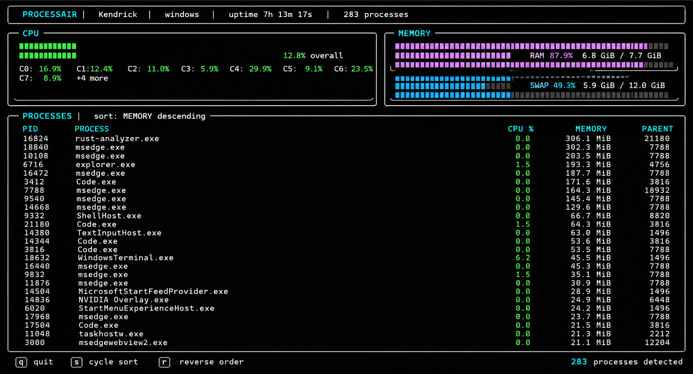

# 🖥️ Processair

**Processair 0.1.0** is a lightweight, cross-platform system monitor written in Rust. It provides real-time visibility into CPU usage, memory consumption, and running processes through an interactive terminal dashboard.

This is an intentionally modular learning project. Its system collector, metric models, application state, and terminal interface are separated to keep the codebase maintainable as new capabilities are introduced.

🌐 **[Explore my Complete Portfolio](https://www.kennykrichardson.com)**

## ✨ Features

### 📊 System Monitoring
- Overall CPU utilization.
- Per-core CPU usage, displaying the first eight cores.
- RAM usage and availability.
- Swap memory usage.

### ⚙️ Process Management and Inspection
- Live list of running processes.
- Process ID (PID).
- Process name.
- CPU utilization per process.
- Memory consumption per process.
- Parent process ID (PPID).
- Sort processes by CPU usage, memory consumption, or name.
- Reverse the current sorting order.

### 🖥️ Terminal Interface
- Interactive terminal dashboard built with Ratatui.
- Keyboard-driven navigation and controls.
- One-second automatic refresh interval.
- Cross-platform system information collection through `sysinfo`.

## 🛠️ Tech Stack

| Technology | Purpose |
|---|---|
| Rust | Core programming language |
| sysinfo | System and process information |
| Ratatui | Terminal user interface |
| Crossterm | Terminal input and control |
| Tokio | Asynchronous runtime |
| Serde | Serialization and deserialization |
| rusqlite | SQLite integration for planned persistence |
| tracing | Application diagnostics |
| thiserror | Error handling |

## 📋 Requirements

- Rust stable 1.95 or newer.
- Windows, Linux, or macOS.
- A terminal that supports alternate-screen mode and ANSI colors.

The current `sysinfo` release used by this project requires Rust 1.95.

Install or update Rust using [rustup](https://rustup.rs/).

## 🚀 Getting Started

### 1. Clone the repository

```bash
git clone https://github.com/USERNAME/Processair.git
```

Replace `USERNAME` with the repository owner's GitHub username.

### 2. Navigate to the project directory

```bash
cd Processair
```

### 3. Run the application

```bash
cargo run
```

On the first run, Cargo downloads and compiles the required dependencies. Subsequent runs reuse the build cache.

## Screenshots

### Dashboard



## 🎮 Controls

| Key | Action |
|---|---|
| `q` | Quit the application |
| `Esc` | Quit the application |
| `s` | Cycle sorting: CPU → Memory → Name |
| `r` | Reverse the current sort order |

## 🧪 Development

The following commands are useful when developing or contributing to Processair.

**Format the code:**

```bash
cargo fmt
```

**Run tests:**

```bash
cargo test
```

**Run Clippy with warnings treated as errors:**

```bash
cargo clippy --all-targets --all-features -- -D warnings
```

**Run the application:**

```bash
cargo run
```

## 🏗️ Project Structure

```text
Processair/
├── Cargo.toml
├── Cargo.lock
├── README.md
├── LICENSE
└── src/
    ├── main.rs
    ├── app.rs
    ├── collectors/
    │   └── system.rs
    ├── models/
    │   └── metrics.rs
    └── ui/
        ├── mod.rs
        └── dashboard.rs
```

### 📁 Module Responsibilities

| Module | Responsibility |
|---|---|
| `main.rs` | Application entry point and initialization |
| `app.rs` | Application state, event loop, refresh timing, and sorting |
| `collectors/system.rs` | Collects operating-system metrics using `sysinfo` |
| `models/metrics.rs` | Defines metric structures and formatting helpers |
| `ui/dashboard.rs` | Renders dashboard panels, gauges, and process tables |
| `ui/mod.rs` | Organizes the terminal UI module |

## 🔬 Architecture

Processair separates system data collection from application logic and terminal rendering.

```text
              Operating System
                      │
                      ▼
              SystemCollector
                  (sysinfo)
                      │
                      ▼
             SystemSnapshot
              + ProcessMetric
                      │
           ┌──────────┴──────────┐
           ▼                     ▼
      App State              Metric Data
   (sorting, input,              │
    refresh timing)              │
           │                     │
           └──────────┬──────────┘
                      ▼
              Ratatui Dashboard
```

The terminal interface does not directly query the operating system. Instead, it receives snapshots represented by ordinary Rust data structures.

This separation makes it easier to introduce additional interfaces, such as a desktop application or monitoring API, without coupling them to the system collector.

## 🧠 Implementation Notes

### CPU Sampling

CPU utilization is calculated using differences between successive samples. Consequently, the first CPU reading may be inaccurate or close to zero.

Processair keeps the same `sysinfo::System` instance alive and refreshes it periodically so subsequent readings can use previous samples.

### Resource Permissions

Some operating-system metrics may be hidden or restricted depending on platform permissions.

Process names may also be truncated by the operating system. Processair displays the information available to the current user account and does not attempt to bypass operating-system permissions.

## 🗺️ Roadmap

| Version | Planned Features | Status |
|---|---|---|
| `0.1.0` | CPU, memory, process collection, terminal dashboard, and sorting | ✅ Completed |
| `0.2.0` | Process search, filtering, selection, and safe termination | 🔜 Planned |
| `0.3.0` | Disk and network monitoring | 🔜 Planned |
| `0.4.0` | Historical metrics and SQLite persistence | 🔜 Planned |
| `0.5.0` | Alerts and configurable thresholds | 🔜 Planned |
| `0.6.0` | Platform-specific collector improvements and profiling | 🔜 Planned |
| `1.0.0` | Stable CLI behavior and documentation | 🔜 Planned |

## 🔒 Safety

Processair 0.1.0 is strictly read-only.

It does not:
- Terminate running processes.
- Modify process priorities.
- Edit user files.
- Change operating-system settings.

Process management capabilities are planned for a future release and will be introduced with appropriate safeguards.

## 🤝 Contributing

Contributions, bug reports, and suggestions are welcome.

If you would like to contribute:

1. Fork the repository.
2. Create a feature branch.
3. Make your changes.
4. Run formatting, tests, and Clippy.
5. Submit a pull request describing your changes.

Please keep contributions consistent with the project's modular architecture.

## 📄 License

Processair is distributed under the **MIT License**. See the [LICENSE](LICENSE) file for details.

# 🛠️ Engineered by Kenny Richardson Kodipally
